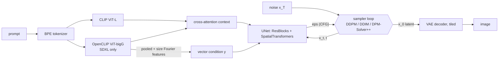

# Stable Diffusion from Scratch

[](https://colab.research.google.com/github/qpp112/stable-diffusion-from-scratch/blob/main/notebooks/demo.ipynb)
  

A from-scratch PyTorch implementation of **Stable Diffusion 1.5** and **SDXL**: UNet, VAE, both CLIP
text encoders, the BPE tokenizer, and **DDPM / DDIM / DPM-Solver / DPM-Solver++** samplers, plus the
memory optimisations needed to generate **1024x1024** images on consumer GPUs. The official pretrained
weights are loaded into these hand-written modules; `diffusers`, `transformers` and `k-diffusion`
are not used at runtime (only for the optional parity check).

```python
from sdscratch.pipeline import PRESETS, StableDiffusion

pipe = StableDiffusion.from_pretrained("sdxl", memory=PRESETS["balanced"])   # model offload + tiled VAE
image = pipe("a red fox in a snowy birch forest, golden hour", steps=25, sampler="dpm++2m", seed=0)[0]
```

<!-- TODO(Qui): add a 2x2 gallery from scripts/generate.py here (assets/gallery_*.jpg). -->

## Highlights

- **Every component written by hand**, with parameter names that mirror the original
  `ldm`/`sgm` code, so the official single-file checkpoints load with `strict=True`. The parameter
  counts match the released models exactly (UNet 859,520,964 / 2,567,463,684; VAE 83,653,863;
  CLIP-L 123,060,480; OpenCLIP-bigG 694,659,840); see `tests/test_models.py`.
- **Samplers derived from the papers and verified numerically.** With an exact score (a Gaussian, and
  a Gaussian mixture), the tests check each solver's order of accuracy: DDIM is 1st order, DPM-Solver(++)
  2M is 2nd order, and the 3M local error is O(h^4) ([derivation](docs/samplers.md)).
- **Memory optimisations, each one optional and composable:** fp16 weights, fused SDPA or sliced
  attention, tiled VAE decoding with feathered seams, sequential CFG, model offload and block-wise UNet
  streaming ([where the memory goes](docs/memory.md)). Tests check that offloading, attention
  backends and CFG batching leave the output unchanged.
- **Low-RAM loading:** modules are built on the `meta` device and checkpoint tensors are streamed in
  one at a time and *assigned*, so SDXL loads with ~7 GB of host RAM instead of more than 10 GB.
- **Reproducible experiments:** an exact-score toy study (CPU), a VRAM/speed ladder that can
  emulate an 8 GB card on a bigger GPU, a sampler grid on the real model, and a numerical parity check
  against `diffusers`. Each one is a single script (Colab notebook + UCI HPC3 SLURM jobs included).

## Results

### Sampler accuracy with an exact score (toy, CPU-reproducible)

An 8-mode 2-D Gaussian mixture has a closed-form noisy score, so any error is **solver** error.
Samplers use Stable Diffusion's exact noise schedule and timestep grids (`python scripts/toy_gmm.py`).


| RMSE to the exact probability-flow ODE solution | 10 NFE | 20 NFE |
|---|---:|---:|
| DDIM | 0.060 | 0.025 |
| DPM-Solver-2M | **0.015** | 0.0077 |
| DPM-Solver++(2M) | 0.047 | 0.0098 |
| DPM-Solver-3M | 0.023 | **0.0060** |
| DPM-Solver++(3M) | 0.095 | 0.0080 |
| *DPM-Solver++(2M) with `trailing` / `linspace` timesteps* | *0.144 / 0.366* | *0.081 / 0.238* |

What the toy study shows:
1. **The timestep grid matters as much as the solver.** Grids that are uniform in *t* leave a few huge
   steps in log-SNR near t = 0, and those steps dominate the error. Karras / log-SNR grids cut the error
   3-16x at 10 NFE, which is why `karras` is the pipeline default.
2. **Higher order wins without guidance, given enough steps:** at 20 NFE every multistep solver is
   2.5-4x more accurate than DDIM. At 10 NFE the noise-prediction variants do best, and
   DPM-Solver++(3M) has not yet caught up (each step needs history from the previous steps).
3. **Strong guidance makes the ODE stiff** (`assets/toy_guidance.png`): for guidance scale w >= 5 at
   <= 20 NFE, first-order DDIM is *more* accurate than the 2nd/3rd-order solvers, and 3M degrades
   first. This is one reason 2M (not 3M) is the usual choice for guided sampling.


### Memory at 1024x1024

Analytic breakdown (details in [docs/memory.md](docs/memory.md)):

| | SDXL weights | largest attention buffer (naive, CFG batch) |
|---|---:|---:|
| fp32 | 12.9 GiB | 0.63 GiB / layer (SD 1.5: **8.0 GiB** / layer) |
| fp16 (+ fp32 VAE) | 6.6 GiB | 0 with fused SDPA kernels |
| + model offload | 4.8 GiB resident | |
| + block-wise UNet offload | ~0.8 GiB resident | |

Measured ladder (each row adds one optimisation): `python scripts/benchmark_memory.py --model sdxl`.
Add `--vram-limit-gb 8` to cap the allocator, so a Colab or HPC GPU behaves like an 8 GB consumer card.

<!-- TODO(Qui): paste results/memory_sdxl_1024.md (+ the _limit8gb variant) and results/memory_sdxl_1024.png here. -->

### Real-model sampler comparison and parity with diffusers

`python scripts/compare_samplers.py --model sd15` renders a sampler x NFE grid and plots latent
error against a 500-step reference. `python scripts/parity_check.py --model sdxl` compares every
component with the `diffusers` implementation on identical inputs: tokenizer ids, text encoders, UNet
(including SDXL size conditioning), VAE encoder and decoder.

<!-- TODO(Qui): add results/samplers_sd15_seed0_grid.jpg and the parity table. -->

## How it works



| | SD 1.5 | SDXL |
|---|---|---|
| UNet levels / channels | 4 / 320-640-1280-1280 | 3 / 320-640-1280 |
| transformer depth per level | 1, 1, 1, 1 (mid 1) | 0, 2, 10 (mid 10) |
| attention heads | 8 per block | 64-dim heads |
| text conditioning | CLIP-L last layer (768) | CLIP-L + bigG penultimate layers (768 + 1280 = 2048) |
| extra conditioning | - | pooled bigG embedding + (orig size, crop, target size) -> 2816-d vector |
| native resolution | 512 | 1024 |

Implementation notes:
- **Checkpoint conversion.** SDXL's second text encoder is stored in OpenCLIP layout (fused `in_proj`,
  `resblocks`, `text_projection` used as `x @ P`). `loader.convert_openclip` splits and renames it into
  the same layout as the first encoder. A round-trip test checks the conversion.
- **Unconditional branch.** SDXL was trained with *zeroed* embeddings for dropped prompts, so an empty
  negative prompt uses zeros rather than encoding `""`. This matches the reference pipelines.
- **fp16 VAE overflow.** The SDXL VAE produces NaNs in fp16, so it runs in fp32. Tiling keeps this cheap.
- **Fractional timesteps.** Karras and log-SNR grids evaluate the UNet at non-integer t, interpolating
  log(sigma/alpha) between the 1000 training steps.

## Quickstart

```bash
git clone https://github.com/qpp112/stable-diffusion-from-scratch.git && cd stable-diffusion-from-scratch
pip install -e ".[dev]"
pytest -q                                   # ~1 min on CPU; no model downloads

python scripts/generate.py --model sdxl --prompt "a watercolor fox in a snowy forest" --preset balanced
python scripts/generate.py --model sd15 --prompt "a lighthouse at dusk" --sampler ddim --steps 50
```

Options: `--sampler {ddpm, ddim, dpm1, dpm2m, dpm3m, dpm++1, dpm++2m, dpm++3m}`,
`--spacing {karras, logsnr, trailing, leading, linspace}`, `--preset {fast, balanced, low, minimal}`,
plus `--offload`, `--attention`, `--vae-tiling`, `--dtype` to override individual settings.

- **Colab:** open `notebooks/demo.ipynb` (badge above).
- **UCI HPC3:** `bash hpc3/setup_env.sh`, then `sbatch hpc3/benchmark.slurm` (runs the tests and all experiments).

## Repository layout

```
sdscratch/
  models/attention.py   multi-head attention: SDPA / sliced / naive backends
  models/clip.py        CLIP text transformer (ViT-L and ViT-bigG configs)
  models/unet.py        conditional UNet (SD 1.5 and SDXL configs)
  models/vae.py         KL autoencoder + tiled decoding
  samplers/schedule.py  noise schedule, timestep grids (incl. Karras / log-SNR), parameterisations
  samplers/samplers.py  DDPM, DDIM, DPM-Solver(++) multistep orders 1-3
  tokenizer.py          byte-level BPE
  loader.py             safetensors streaming, meta-device construction, OpenCLIP -> HF conversion
  memory.py             offloading + peak-memory tracking
  pipeline.py           text-to-image with classifier-free guidance
  toy.py                Gaussian-mixture diffusion with an exact score
scripts/                generate, benchmark_memory, compare_samplers, parity_check, toy_gmm
tests/                  samplers (NumPy only), models + pipeline (tiny configs), tokenizer
docs/                   samplers.md (derivations), memory.md (memory analysis)
notebooks/demo.ipynb    Colab demo
hpc3/                   SLURM jobs for UCI HPC3
```

## References

Rombach et al., *High-Resolution Image Synthesis with Latent Diffusion Models* (CVPR 2022) ·
Podell et al., *SDXL* (2023) · Ho et al., *DDPM* (2020) · Song et al., *DDIM* (2021) ·
Lu et al., *DPM-Solver* (2022) and *DPM-Solver++* (2022) · Karras et al., *EDM* (2022) ·
Ho & Salimans, *Classifier-Free Diffusion Guidance* (2022) · Radford et al., *CLIP* (2021) ·
Dao et al., *FlashAttention* (2022).

Weights: [SD 1.5](https://huggingface.co/stable-diffusion-v1-5/stable-diffusion-v1-5) (CreativeML OpenRAIL-M),
[SDXL base 1.0](https://huggingface.co/stabilityai/stable-diffusion-xl-base-1.0) (CreativeML OpenRAIL++-M).
They are downloaded at runtime and not redistributed here.
