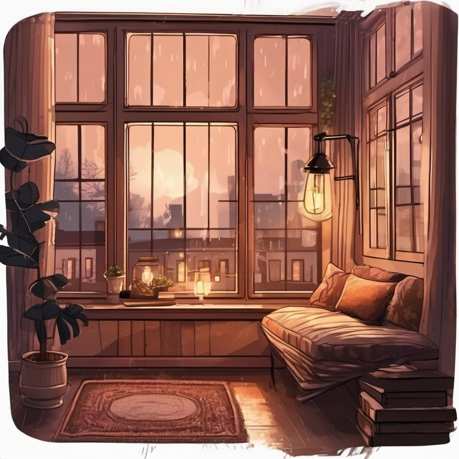
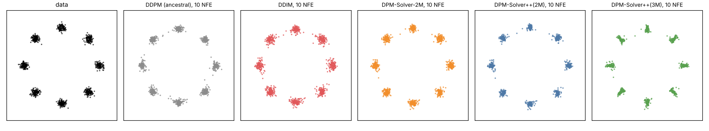
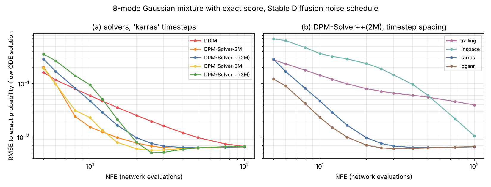
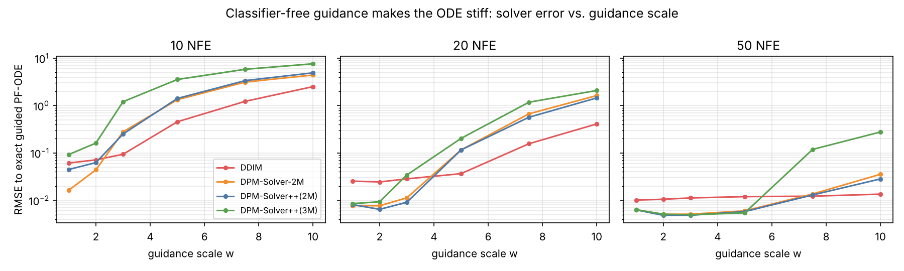
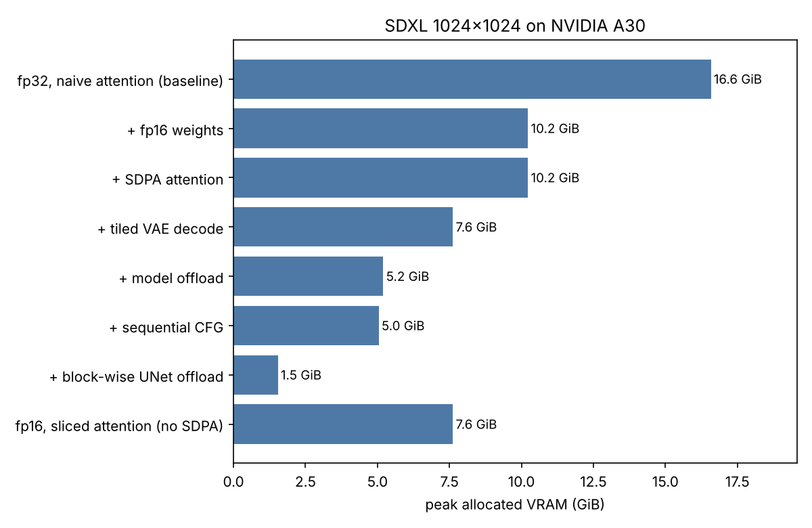
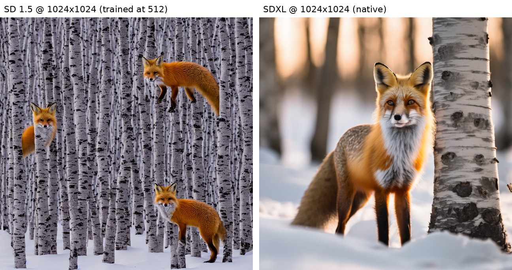
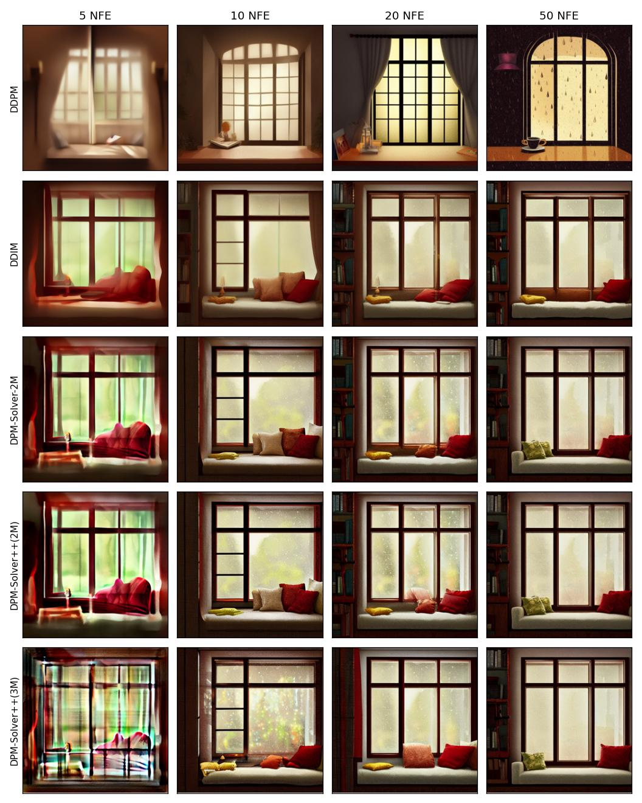
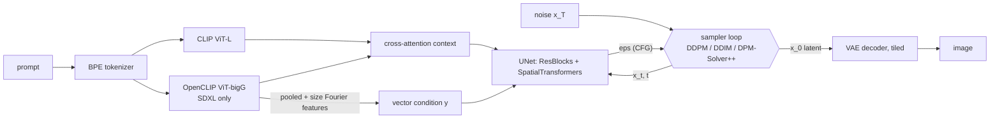

# Stable Diffusion

[](https://colab.research.google.com/github/qpp112/Stable-Diffusion/blob/main/notebooks/demo.ipynb)
  

A plain-PyTorch implementation of **Stable Diffusion 1.5** and **SDXL**: UNet, VAE, both CLIP
text encoders, the BPE tokenizer, and **DDPM / DDIM / DPM-Solver / DPM-Solver++** samplers, plus the
memory optimisations needed to generate **1024x1024** images on consumer GPUs. The official pretrained
weights are loaded into this repo's modules; `diffusers`, `transformers` and `k-diffusion`
are not used at runtime (only for the optional parity check).

```python
from sdscratch.pipeline import PRESETS, StableDiffusion

pipe = StableDiffusion.from_pretrained("sdxl", memory=PRESETS["balanced"])   # model offload + tiled VAE
image = pipe("a red fox in a snowy birch forest, golden hour", steps=25, sampler="dpm++2m", seed=0)[0]
```

| SD 1.5, 512 px | SDXL, 1024 px | SDXL, 1024 px |
|:---:|:---:|:---:|
|  |  |  |
| *a lighthouse on a cliff at dusk, oil painting* | *a red fox in a snowy birch forest, golden hour, 85mm photograph* | *a cozy reading nook with a large window, rainy evening, warm lamp light, detailed illustration* |

All three were generated by this code: DPM-Solver++(2M), Karras timesteps, seed 0, 25 steps (the right image
is the 200-step reference from the sampler comparison). The SDXL fox used the `balanced` preset (model
offload + tiled VAE).

## Highlights

- **SDXL at 1024x1024 in 5.2 GiB of GPU memory** (vs 16.6 GiB for the fp32 baseline), at 0.30 s per
  denoising step on an NVIDIA A30. It still runs with the allocator capped at 8 GiB, like a consumer card.
  Block-wise offloading brings it to **1.5 GiB**, but each step is about 10x slower. These numbers are
  measured, not estimated ([results](#memory-at-1024x1024)).
- **Every component implemented in this repo**, with parameter names that mirror the original
  `ldm`/`sgm` code, so the official single-file checkpoints load with `strict=True`. The parameter
  counts match the released models exactly (UNet 859,520,964 / 2,567,463,684; VAE 83,653,863;
  CLIP-L 123,060,480; OpenCLIP-bigG 694,659,840); see `tests/test_models.py`.
- **Numerically equal to the reference implementation.** On identical inputs, the tokenizer, the text
  encoders and the SD 1.5 UNet match `diffusers` bit for bit. The SDXL UNet and the VAE agree to within
  fp16 round-off (<= 0.5% relative); see [Parity with diffusers](#parity-with-diffusers).
- **Samplers derived from the papers and verified numerically.** With an exact score (a Gaussian, and
  a Gaussian mixture), the tests check each solver's order of accuracy: DDIM is 1st order, DPM-Solver(++)
  2M is 2nd order, and the 3M local error is O(h^4) ([derivation](docs/samplers.md)).
- **Memory optimisations, each one optional and composable:** fp16 weights, fused SDPA or sliced
  attention, tiled VAE decoding with feathered seams, sequential CFG, model offload and block-wise UNet
  streaming ([where the memory goes](docs/memory.md)). Tests check that offloading, attention
  backends and CFG batching leave the output unchanged.
- **Low-RAM loading:** modules are built on the `meta` device and checkpoint tensors are streamed in
  one at a time and *assigned*, so SDXL loads with ~7 GB of host RAM instead of more than 10 GB.
- **Reproducible experiments:** an exact-score toy study (CPU), a VRAM/speed ladder that can
  emulate an 8 GB card on a bigger GPU, a sampler grid on the real model, and a numerical parity check
  against `diffusers`. Each one is a single script. The results here come from one SLURM job on UCI's
  HPC3 cluster (log in [`results/hpc3_job_log.txt`](results/hpc3_job_log.txt)); a Colab notebook is
  included too.

## Results

### Sampler accuracy with an exact score (toy, CPU-reproducible)

An 8-mode 2-D Gaussian mixture has a closed-form noisy score, so any error is **solver** error.
Samplers use Stable Diffusion's exact noise schedule and timestep grids (`python scripts/toy_gmm.py`).




| RMSE to the exact probability-flow ODE solution | 10 NFE | 20 NFE |
|---|---:|---:|
| DDIM | 0.060 | 0.025 |
| DPM-Solver-2M | **0.015** | 0.0077 |
| DPM-Solver++(2M) | 0.047 | 0.0098 |
| DPM-Solver-3M | 0.023 | **0.0060** |
| DPM-Solver++(3M) | 0.095 | 0.0080 |
| *DPM-Solver++(2M) with `trailing` / `linspace` timesteps* | *0.144 / 0.366* | *0.081 / 0.238* |

What the toy study shows:
1. **The timestep grid matters as much as the solver.** Grids that are uniform in *t* leave a few huge
   steps in log-SNR near t = 0, and those steps dominate the error. Karras / log-SNR grids cut the error
   3-16x at 10 NFE, which is why `karras` is the pipeline default.
2. **Higher order wins without guidance, given enough steps:** at 20 NFE every multistep solver is
   2.5-4x more accurate than DDIM. At 10 NFE the noise-prediction variants do best, and
   DPM-Solver++(3M) has not yet caught up (each step needs history from the previous steps).
3. **Strong guidance makes the ODE stiff** (`assets/toy_guidance.png`): for guidance scale w >= 5 at
   <= 20 NFE, first-order DDIM is *more* accurate than the 2nd/3rd-order solvers, and 3M degrades
   first. This is one reason 2M (not 3M) is the usual choice for guided sampling.



### Memory at 1024x1024

Measured on an NVIDIA A30 (24 GB) on UCI's HPC3 cluster: 20 DPM-Solver++(2M) steps, classifier-free
guidance on. Each row adds one optimisation (`python scripts/benchmark_memory.py --model sdxl`).
Peak = `torch.cuda.max_memory_allocated`; the CUDA context adds a few hundred MB on top.



| SDXL, 1024x1024 | Peak VRAM (GiB) | UNet s/step | Total s |
|---|---:|---:|---:|
| fp32, naive attention (baseline) | 16.58 | 1.50 | 30.4 |
| + fp16 weights (VAE kept in fp32) | 10.23 | 0.31 | 6.7 |
| + SDPA attention | 10.23 | **0.21** | **4.7** |
| + tiled VAE decode | 7.62 | 0.21 | 5.2 |
| + model offload (`balanced` preset) | **5.20** | 0.30 | 7.9 |
| + sequential CFG (`low` preset) | 5.04 | 0.34 | 8.6 |
| + block-wise UNet offload (`minimal` preset) | **1.54** | 2.20 | 45.7 |
| fp16 + sliced attention instead of SDPA (+ tiled VAE) | 7.62 | 0.33 | 7.5 |

What the per-stage numbers in [`results/memory_sdxl_1024.json`](results/memory_sdxl_1024.json) show:
- **Fused attention is about speed for SDXL.** SDPA lowers the UNet-stage peak from 8.2 to 7.0 GiB and
  makes each step 1.5x faster, but the overall peak doesn't move. With all weights resident, the
  **VAE decode** sets the peak at 10.2 GiB, and only tiled decoding brings it down.
- **Model offload is the sweet spot:** 5.2 GiB fits an 8 GB consumer card with room to spare. It adds
  about 3 s per image to move each component's weights onto the GPU. The table's s/step column includes
  that transfer, which is why it rises from 0.21 to 0.30.
- **Block-wise offload** streams the UNet through the GPU one block at a time. The peak becomes the
  text encoders (1.5 GiB), but every step copies the whole UNet, so it is 10x slower.
- **The image doesn't change.** Compared with the fp16 + SDPA image (PSNR): fp32 48 dB, tiled VAE 42 dB
  with no visible seams, model offload bit-identical to the tiled run, sequential CFG 41 dB.

For SD 1.5 at 1024x1024 (A30), attention is what breaks. **Naive attention runs out of memory even in
fp16 on a 24 GB card.** The failed allocation is exactly **8.00 GiB**, the size of one
16,384 x 16,384 attention matrix x 8 heads x 2 (CFG) predicted in [docs/memory.md](docs/memory.md):

| SD 1.5, 1024x1024 | Peak VRAM (GiB) | UNet s/step |
|---|---:|---:|
| fp32 / fp16, naive attention | OOM (tried to allocate 16.00 / 8.00 GiB) | - |
| fp16 + SDPA | 4.48 | 0.20 |
| + tiled VAE / + model offload / + sequential CFG | 2.57 / 2.15 / 1.89 | 0.20 / 0.22 / 0.25 |
| + block-wise UNet offload | 0.72 | 0.91 |
| fp16 + sliced attention (+ tiled VAE) | 3.31 | 0.48 |

But fitting in memory isn't enough. SD 1.5 was trained at 512 px, and at 1024 px it tiles the scene and
repeats the subject. SDXL, trained at 1024 px, doesn't (same prompt, same seed):



**Does it really fit an 8 GB card?** Rerunning the SDXL ladder with PyTorch's allocator capped at 8 GiB
(`--vram-limit-gb 8`) gives a direct answer:
- **Fails:** fp16 alone and fp16 + SDPA run out of memory, because the full-size VAE decode needs 10.2 GiB.
- **Fits:** everything from tiled VAE decoding onward completes with the same peaks and speeds as
  uncapped. That covers tiled VAE (7.6 GiB), model offload (5.2 GiB), sequential CFG (5.0 GiB) and
  block-wise offload (1.5 GiB).

The capped results are in [`results/memory_sdxl_1024_limit8gb.md`](results/memory_sdxl_1024_limit8gb.md).

### Sampler comparison on the real model

Same prompt, seed and initial noise. Only the solver and the number of network evaluations (NFE) change
(`python scripts/compare_samplers.py --model sd15`). SD 1.5, guidance 7.5, Karras timesteps:



| Latent RMSE to a 500-step reference | 5 NFE | 10 NFE | 20 NFE | 50 NFE |
|---|---:|---:|---:|---:|
| DDIM | **0.66** | **0.50** | 0.38 | 0.34 |
| DPM-Solver-2M | 0.71 | 0.53 | **0.33** | 0.17 |
| DPM-Solver++(2M) | 0.79 | 0.56 | 0.34 | 0.17 |
| DPM-Solver++(3M) | 0.92 | 0.55 | 0.43 | **0.025** |

These results match the exact-score toy study:
- **With strong guidance and very few steps, the first-order solver is the most robust.** At 5 NFE,
  DDIM is closest to the reference, and DPM-Solver++(3M) produces visible artefacts.
- The 2M solvers lead at 20 NFE. **At 50 NFE, 3M is 7x closer than 2M** (0.025 vs 0.17).
- DDIM at 50 NFE still lands on a slightly different picture (look at the left cushion), which is why its
  error barely moves between 20 and 50 NFE.
- DDPM is stochastic, so it gives a different image at each NFE and needs the most steps.

This is one prompt and one seed, so treat it as a qualitative check. The SDXL version (guidance 6,
200-step reference) is in [`results/samplers_sdxl_seed0_grid.jpg`](results/samplers_sdxl_seed0_grid.jpg).
There, all the deterministic solvers give nearly the same picture from 10 NFE on.

### Parity with diffusers

`python scripts/parity_check.py --model sdxl` feeds identical inputs to this implementation and to
`diffusers` and compares tokenizer ids, text encoders, UNet (including SDXL size conditioning), and the
VAE encoder and decoder.

**Every component passes for both models** (fp16 on GPU; relative = max |ours - diffusers| / max |diffusers|):

| Component | SD 1.5 | SDXL |
|---|---:|---:|
| Tokenizer ids | identical | identical (both tokenizers) |
| Text encoder(s) | 0 (bit-identical) | 0 (bit-identical, both encoders + pooled embedding) |
| UNet noise prediction | 0 (bit-identical) | 1.5e-3 (incl. size conditioning) |
| VAE encoder (fp32) | 4.5e-3 | 6.4e-4 |
| VAE decoder (fp32) | 1.6e-3 | 2.6e-3 |

This repo's tokenizer, text encoders and SD 1.5 UNet reproduce the reference **bit for bit**. The
remaining differences are fp16 and kernel round-off. One detail for SD 1.5: diffusers loads its VAE in fp16
and upcasts it, while this code reads the checkpoint's fp32 weights directly. Raw outputs are in
[`results/parity_sd15.txt`](results/parity_sd15.txt) and [`results/parity_sdxl.txt`](results/parity_sdxl.txt).

## How it works



| | SD 1.5 | SDXL |
|---|---|---|
| UNet levels / channels | 4 / 320-640-1280-1280 | 3 / 320-640-1280 |
| transformer depth per level | 1, 1, 1, 1 (mid 1) | 0, 2, 10 (mid 10) |
| attention heads | 8 per block | 64-dim heads |
| text conditioning | CLIP-L last layer (768) | CLIP-L + bigG penultimate layers (768 + 1280 = 2048) |
| extra conditioning | - | pooled bigG embedding + (orig size, crop, target size) -> 2816-d vector |
| native resolution | 512 | 1024 |

Implementation notes:
- **Checkpoint conversion.** SDXL's second text encoder is stored in OpenCLIP layout (fused `in_proj`,
  `resblocks`, `text_projection` used as `x @ P`). `loader.convert_openclip` splits and renames it into
  the same layout as the first encoder. A round-trip test checks the conversion.
- **Unconditional branch.** SDXL was trained with *zeroed* embeddings for dropped prompts, so an empty
  negative prompt uses zeros rather than encoding `""`. This matches the reference pipelines.
- **fp16 VAE overflow.** The SDXL VAE produces NaNs in fp16, so it runs in fp32. Tiling keeps this cheap.
- **Fractional timesteps.** Karras and log-SNR grids evaluate the UNet at non-integer t, interpolating
  log(sigma/alpha) between the 1000 training steps.

## Quickstart

```bash
git clone https://github.com/qpp112/Stable-Diffusion.git && cd Stable-Diffusion
pip install -e ".[dev]"
pytest -q                                   # ~1 min on CPU; no model downloads

python scripts/generate.py --model sdxl --prompt "a watercolor fox in a snowy forest" --preset balanced
python scripts/generate.py --model sd15 --prompt "a lighthouse at dusk" --sampler ddim --steps 50
```

Options: `--sampler {ddpm, ddim, dpm1, dpm2m, dpm3m, dpm++1, dpm++2m, dpm++3m}`,
`--spacing {karras, logsnr, trailing, leading, linspace}`, `--preset {fast, balanced, low, minimal}`,
plus `--offload`, `--attention`, `--vae-tiling`, `--dtype` to override individual settings.

- **Colab:** open `notebooks/demo.ipynb` (badge above).
- **UCI HPC3:** step-by-step setup in [`hpc3/README.md`](hpc3/README.md), then `sbatch hpc3/benchmark.slurm` (runs the tests and all experiments).

## Repository layout

```
sdscratch/
  models/attention.py   multi-head attention: SDPA / sliced / naive backends
  models/clip.py        CLIP text transformer (ViT-L and ViT-bigG configs)
  models/unet.py        conditional UNet (SD 1.5 and SDXL configs)
  models/vae.py         KL autoencoder + tiled decoding
  samplers/schedule.py  noise schedule, timestep grids (incl. Karras / log-SNR), parameterisations
  samplers/samplers.py  DDPM, DDIM, DPM-Solver(++) multistep orders 1-3
  tokenizer.py          byte-level BPE
  loader.py             safetensors streaming, meta-device construction, OpenCLIP -> HF conversion
  memory.py             offloading + peak-memory tracking
  pipeline.py           text-to-image with classifier-free guidance
  toy.py                Gaussian-mixture diffusion with an exact score
scripts/                generate, benchmark_memory, compare_samplers, parity_check, toy_gmm
tests/                  samplers (NumPy only), models + pipeline (tiny configs), tokenizer
docs/                   samplers.md (derivations), memory.md (memory analysis)
notebooks/demo.ipynb    Colab demo
hpc3/                   SLURM jobs for UCI HPC3
```

## References

Rombach et al., *High-Resolution Image Synthesis with Latent Diffusion Models* (CVPR 2022) ·
Podell et al., *SDXL* (2023) · Ho et al., *DDPM* (2020) · Song et al., *DDIM* (2021) ·
Lu et al., *DPM-Solver* (2022) and *DPM-Solver++* (2022) · Karras et al., *EDM* (2022) ·
Ho & Salimans, *Classifier-Free Diffusion Guidance* (2022) · Radford et al., *CLIP* (2021) ·
Dao et al., *FlashAttention* (2022).

Weights: [SD 1.5](https://huggingface.co/stable-diffusion-v1-5/stable-diffusion-v1-5) (CreativeML OpenRAIL-M),
[SDXL base 1.0](https://huggingface.co/stabilityai/stable-diffusion-xl-base-1.0) (CreativeML OpenRAIL++-M).
They are downloaded at runtime and not redistributed here.
